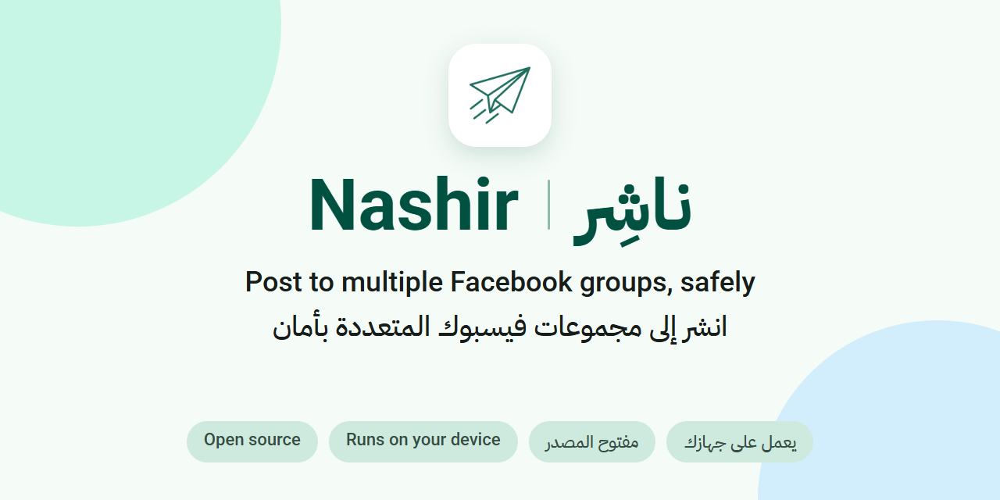
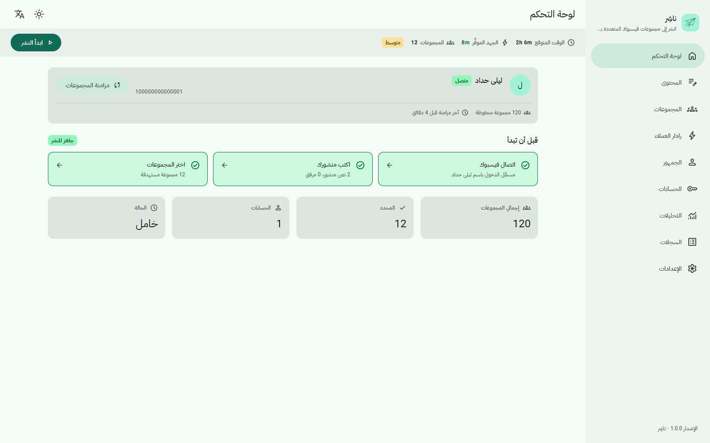
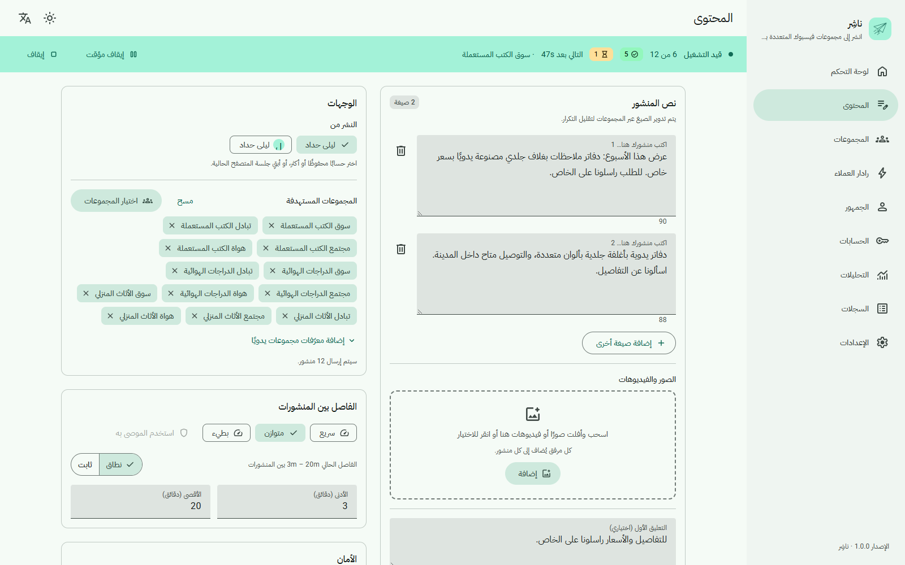
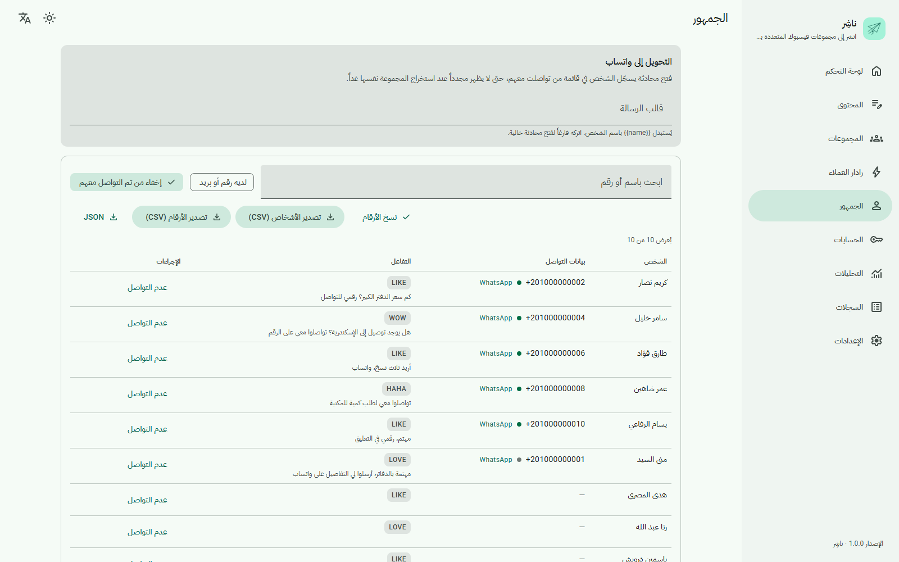
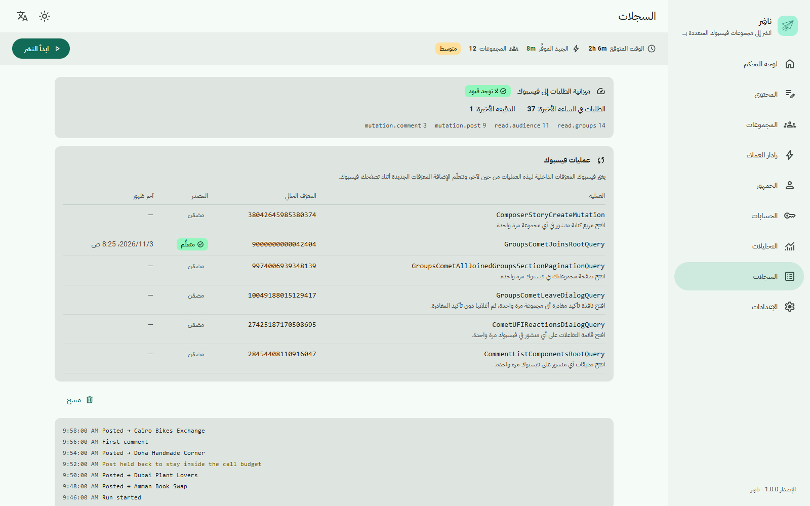
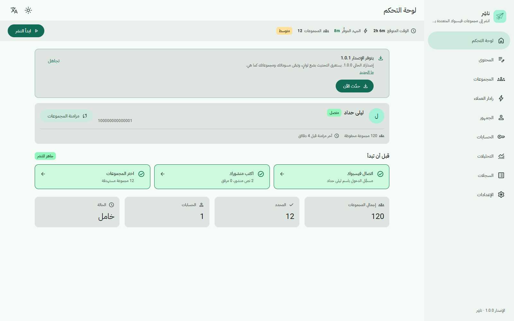

<div align="center" dir="rtl">



# ناشِر (Nashir)

**انشر في مجموعات فيسبوك المتعددة، بأمان. إضافة مجانية لمتصفح Chrome، عربية أولًا.**

[](https://github.com/abdumezar/extensions.facebook.auto/actions/workflows/ci.yml)
[](https://github.com/abdumezar/extensions.facebook.auto/releases/latest)
[](LICENSE)
[](https://github.com/abdumezar/extensions.facebook.auto/releases)

[English](README.md) | العربية

[التنزيل](https://github.com/abdumezar/extensions.facebook.auto/releases/latest) · [الموقع](https://abdumezar.github.io/extensions.facebook.auto/) · [سجل التغييرات](CHANGELOG.md)

</div>

<div dir="rtl">

> **تنبيه:** يؤتمت ناشِر نقاط فيسبوك الداخلية باستخدام جلسة حسابك المفتوحة في المتصفح. وهذا مخالف لشروط فيسبوك، وتستخدمه على مسؤوليتك، وقد يُقيَّد حسابك. راجع [إخلاء المسؤولية](#disclaimer).



تكتب منشورك مرة واحدة وتختار المجموعات، فينشره ناشِر في كل مجموعة بوتيرة آمنة. ويخبرك بما نجح في كل مجموعة، ويتوقف إذا طلب فيسبوك تحققًا أو أشار إلى حدّ معيّن. وفيه حاكم أمان مدمج يُبقي كل طلب إلى فيسبوك ضمن ميزانية محددة، مع فترات تهدئة وتحكّم في الوتيرة. وكل شيء يبقى على جهازك: لا خادم ولا تتبّع ولا حساب.

يتطلب Chrome 116 أو أحدث.

## المحتويات

- [المزايا](#features)
- [التثبيت](#install)
- [التحديث](#updating)
- [نموذج الأمان](#safety)
- [الخصوصية](#privacy)
- [إخلاء المسؤولية](#disclaimer)
- [البناء من المصدر](#build)
- [بنية المشروع](#structure)
- [المساهمة](#contributing)
- [الرخصة](#license)
- [عن المطوّر](#about)

<a id="features"></a>

## المزايا

- **الحملات.** انشر في عدة مجموعات دفعة واحدة، مع فواصل زمنية لكل حملة ونتيجة لكل مجموعة.
- **حسابات متعددة.** شغّل حملاتك من عدة حسابات فيسبوك تملكها (بالاعتماد على ملفات الارتباط).
- **حاكم الأمان.** ميزانية لطلبات فيسبوك، وفترات تهدئة، وتحكّم في الوتيرة، وحدود لكل ميزة. وتعرض بطاقة **ميزانية الطلبات إلى فيسبوك** في صفحة السجلات أعداد الطلبات الأخيرة، وأثناء التهدئة تعرض القاعدة التي انطبقت.
- **استخراج الجمهور.** اجمع الأشخاص الذين تفاعلوا مع منشور أو علّقوا عليه، بما في ذلك بيانات التواصل التي كتبوها بأنفسهم في تعليق. صدّر القائمة بصيغة CSV أو JSON، أو انتقل منها إلى واتساب.
- **رادار العملاء (Lead Radar).** يفحص مجموعاتك المراقبة كل 15 دقيقة تقريبًا، ويقيّم المنشورات التي تدل على رغبة في الشراء. يعتمد على قواعد بسيطة، لا على أي نموذج.
- **التعليق الأول التلقائي.** أضف رابطك أو تفاصيلك تعليقًا أول تحت المنشور.
- **اكتشاف المجموعات والانضمام إليها.** اعثر على مجموعات جديدة وانضم إليها على دفعات صغيرة: 8 كحد أقصى في اليوم و3 في الدفعة، مع فاصل بين كل انضمام وآخر. ويمكنك أيضًا مغادرة المجموعات.
- **الحسابات الكبيرة.** صفحة المجموعات مقسّمة إلى صفحات، ومزامنة المجموعات قابلة للاستئناف، فتكتمل قوائم المجموعات الضخمة.
- **التحليلات.** تابع ما نشرته، وأين نشرته، وكيف سارت الأمور. وصدّر البيانات بصيغة CSV.
- **بطاقة عمليات فيسبوك.** يغيّر فيسبوك معرّفاته الداخلية (`doc_id`) بين وقت وآخر. يتعلّم ناشِر المعرّفات الجديدة من صفحات فيسبوك نفسها، وتعرض البطاقة أيّها محدّث.
- **تحديث بنقرة واحدة وموقّع.** تأتي الإصدارات الجديدة من إصدارات GitHub، ويُتحقَّق من توقيعها قبل كتابة أي ملف. راجع [التحديث](#updating).
- **عربية أولًا.** واجهة عربية افتراضيًا، وإنجليزية أيضًا، بسمة فاتحة وأخرى داكنة.

<table>
  <tr>
    <td width="50%"><br><sub>حملة قيد التنفيذ: سطر لكل مجموعة مع نتيجتها.</sub></td>
    <td width="50%"><br><sub>صفحة الجمهور، مع عوامل التصفية والتصدير.</sub></td>
  </tr>
  <tr>
    <td width="50%"><br><sub>بطاقة عمليات فيسبوك تبيّن أيّ العمليات محدّثة.</sub></td>
    <td width="50%"><br><sub>شريط التحديث، يظهر عند صدور إصدار جديد.</sub></td>
  </tr>
</table>

<a id="install"></a>

## التثبيت

ناشِر غير موجودة في متجر Chrome الإلكتروني، لأن المتجر لا يناسب هذا النوع من الأتمتة. لذلك تُثبَّت من GitHub. تستغرق دقائق قليلة ولا تحتاج إلى أي أدوات.

1. **نزّل الملف وفك ضغطه.** نزّل الملف `nashir-<version>.zip` من [آخر إصدار](https://github.com/abdumezar/extensions.facebook.auto/releases/latest)، ثم فك ضغطه داخل مجلد عادي مثل `Documents\Nashir`. لا تستخدم `AppData` ولا مجلدًا مؤقتًا ولا مجلد التنزيلات: يقرأ Chrome الإضافة من هذا المجلد في كل مرة يعمل فيها، فيجب أن يبقى في مكانه.
2. **فعّل وضع المطوّر.** اكتب `chrome://extensions` في شريط عنوان Chrome ثم اضغط Enter. فعّل مفتاح **وضع المطوّر** (Developer mode) في الزاوية العلوية.
3. **حمّل المجلد.** اضغط **تحميل إضافة غير مضغوطة** (Load unpacked) واختر المجلد الذي فككت ضغطه. ستظهر ناشِر في القائمة. يمكنك تثبيتها في شريط الأدوات إن أحببت.
4. **اربط المجلد مرة واحدة.** افتح لوحة تحكم ناشِر، ثم اذهب إلى **الإعدادات** ← **التحديثات** واضغط **اربط المجلد**. اختر المجلد نفسه مرة أخرى وأذن بالوصول إليه. بهذا تستطيع الإضافة أن تحدّث نفسها لاحقًا بنقرة واحدة. وإذا تخطيت هذه الخطوة، فسيعرض لك **حدّث الآن** زرًا لاختيار المجلد.

يحتوي الإصدار أيضًا على `nashir-<version>.zip.sig` و`SHA256SUMS`. تستخدم الإضافة التوقيع بنفسها. وإذا أردت أن تتحقق من ملفك يدويًا، فقارن قيمة SHA-256 للملف بالسطر المقابل له في `SHA256SUMS`.

<a id="updating"></a>

## التحديث

عند صدور إصدار جديد يظهر شريط في لوحة التحكم.

1. اضغط **حدّث الآن** في الشريط.
2. أذن بالوصول إلى المجلد إذا طلب Chrome ذلك.
3. يتحقق ناشِر من توقيع الإصدار أولًا. وإذا طابق التوقيع فقط، يكتب الملفات الجديدة ثم تعيد الإضافة تحميل نفسها على الإصدار الجديد.

وإذا كانت حملة أو مهمة أخرى تعمل في الخلفية، يطلب منك ناشِر الانتظار حتى تنتهي، فلا يُقطع شيء في منتصفه.

للتحديث يدويًا: نزّل الملف المضغوط الجديد، وفك ضغطه فوق المجلد نفسه، ثم افتح `chrome://extensions` واضغط **إعادة تحميل** (Reload) على ناشِر.

يستبدل التحديث ملفات الإضافة فقط. أما حملاتك وإعداداتك فيحفظها Chrome في مكان منفصل وتبقى كما هي.

<a id="safety"></a>

## نموذج الأمان

صُمّم ناشِر ليعمل ببطء.

- كل طلب إلى فيسبوك يمر عبر حاكم واحد له ميزانية للطلبات وتحكّم في الوتيرة وفترات تهدئة. وتظهر أعداد الطلبات الأخيرة في صفحة السجلات.
- إذا أشار فيسبوك إلى حدّ معيّن، يتوقف ناشِر مؤقتًا ويعرض القاعدة التي انطبقت.
- إذا طلب فيسبوك أن تؤكد هويتك، يوقف ناشِر كل الطلبات لذلك الحساب حتى تنهي التحقق.
- لكل ميزة حدودها. الانضمام إلى المجموعات مثلًا محدود بـ 8 في اليوم و3 في الدفعة، مع فاصل بين كل انضمام وآخر.
- يُتحقَّق من توقيع التحديث قبل كتابة أي ملف، وإذا فشلت الكتابة يُتراجع عنها.

يقلّل الحاكم خطر التقييد لكنه لا يلغيه.

<a id="privacy"></a>

## الخصوصية

- الحملات والمجموعات والجمهور والإعدادات تُحفظ في متصفحك، على جهازك.
- لا يوجد خادم لناشِر ولا تتبّع ولا حساب. ولا يُجمع شيء عنك أو عن نشاطك.
- غير خوادم فيسبوك نفسها، العنوان الآخر الوحيد الذي تتصل به الإضافة من تلقاء نفسها هو GitHub، للبحث عن التحديثات وتنزيلها. أما الروابط التي تضغط عليها بنفسك، مثل روابط محادثات واتساب، فتُفتح بشكل عادي.
- الشيفرة مفتوحة، فتستطيع أن تقرأ ما تفعله بالضبط.

<a id="disclaimer"></a>

## إخلاء المسؤولية

يؤتمت ناشِر نقاط فيسبوك الداخلية باستخدام جلسة حسابك المفتوحة في المتصفح. وهذا مخالف لشروط فيسبوك، وقد يؤدي إلى فرض قيود على حسابك، ومنها الحظر المؤقت أو الإيقاف. تستخدمه على مسؤوليتك، ولا يتحمل مطوّروه أي مسؤولية عما يحدث لحسابك.

ناشِر مشروع مستقل، لا يتبع فيسبوك أو ميتا ولا يرتبط بهما ولا يحظى بتزكيتهما.

<a id="build"></a>

## البناء من المصدر

تحتاج إلى Node.js 20 أو أحدث (يستخدم CI الإصدار 22) وpnpm 10.

<div dir="ltr">

```bash
pnpm install
pnpm dev
pnpm typecheck
pnpm test
pnpm build
```

</div>

`pnpm dev` يشغّل بناء Vite للتطوير، و`pnpm build` يضع الناتج في `packages/extension/dist`. لتجربة البناء في Chrome، افتح `chrome://extensions`، وفعّل وضع المطوّر، واضغط **تحميل إضافة غير مضغوطة** (Load unpacked)، ثم اختر `packages/extension/dist`.

لإنشاء ملف الإصدار المضغوط (شغّل `pnpm build` أولًا):

<div dir="ltr">

```bash
pnpm --filter @nashir/extension pack:ext
```

</div>

ولإعادة إنشاء لقطات الشاشة الموجودة في هذا الملف:

<div dir="ltr">

```bash
pnpm --filter @nashir/extension screenshots
```

</div>

<a id="structure"></a>

## بنية المشروع

| المسار | المحتوى |
| --- | --- |
| `packages/extension` | إضافة Chrome (MV3) |
| `packages/extension/src/background` | عامل الخدمة (service worker): موجّه الرسائل والمنبّهات وإعداد القواعد |
| `packages/extension/src/engine` | الحملات وحاكم الأمان والمجموعات والجمهور ورادار العملاء |
| `packages/extension/src/platform` | محوّلات رفيعة فوق واجهات Chrome |
| `packages/extension/src/content` | سكربت المحتوى الذي يعمل في facebook.com |
| `packages/extension/src/dashboard` | لوحة التحكم (React)، بالعربية والإنجليزية |
| `packages/extension/src/popup` | نافذة شريط الأدوات |
| `packages/extension/src/update` | البحث عن التحديثات والتحقق من التوقيع وفك الضغط والتطبيق |
| `packages/extension/scripts` | سكربتات البناء والتجميع وتوقيع الإصدارات |
| `packages/shared` | الأنواع وعقود الرسائل وصيغة طلبات فيسبوك |
| `site` | موقع GitHub Pages |

<a id="contributing"></a>

## المساهمة

نرحّب بتقارير الأخطاء والإصلاحات والترجمات والتوثيق. اقرأ [CONTRIBUTING.md](CONTRIBUTING.md) لمعرفة الإعداد والفحوص وأسلوب الالتزامات (commits). وإذا توقفت إحدى العمليات عن العمل، افتح بلاغًا واذكر اسم العملية الظاهر في بطاقة عمليات فيسبوك.

أبلغ عن المشكلات الأمنية بشكل خاص، ولا تفعل ذلك في بلاغ علني أبدًا. راجع [SECURITY.md](SECURITY.md).

نرجو الالتزام بـ[مدونة السلوك](CODE_OF_CONDUCT.md).

<a id="license"></a>

## الرخصة

ناشِر منشورة بموجب [رخصة جنو العمومية الإصدار 3](LICENSE) (GPL-3.0-only).

<a id="about"></a>

## عن المطوّر

ABOUT-PENDING

</div>
