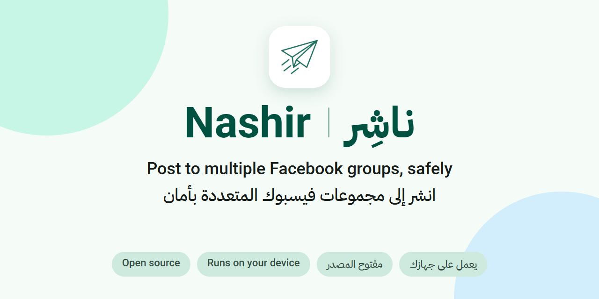
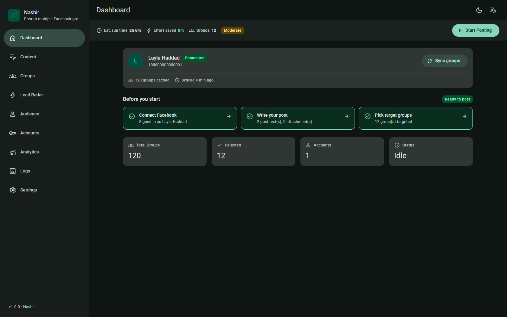
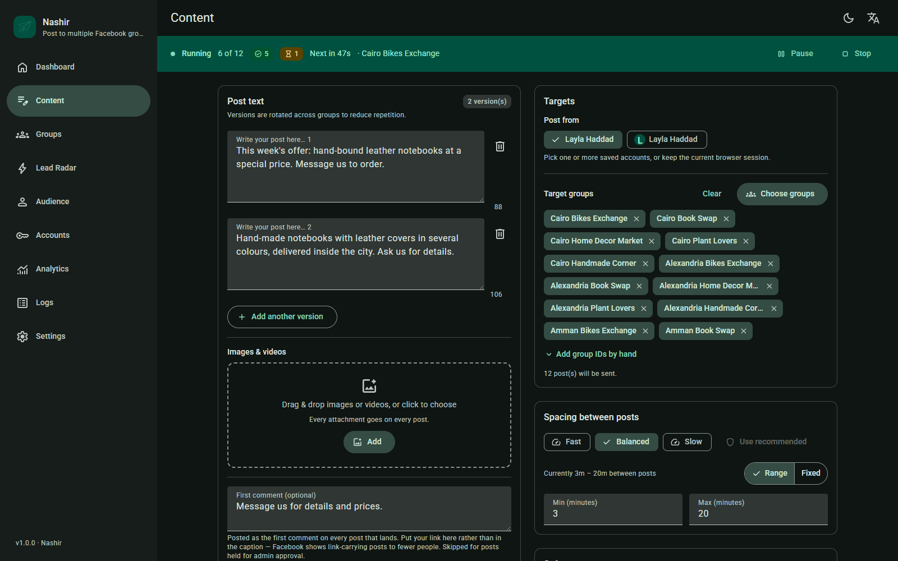
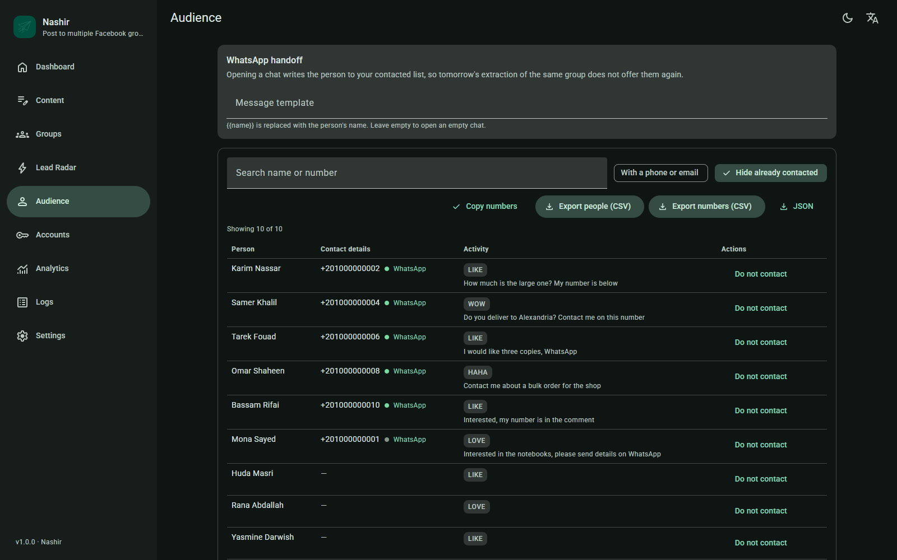
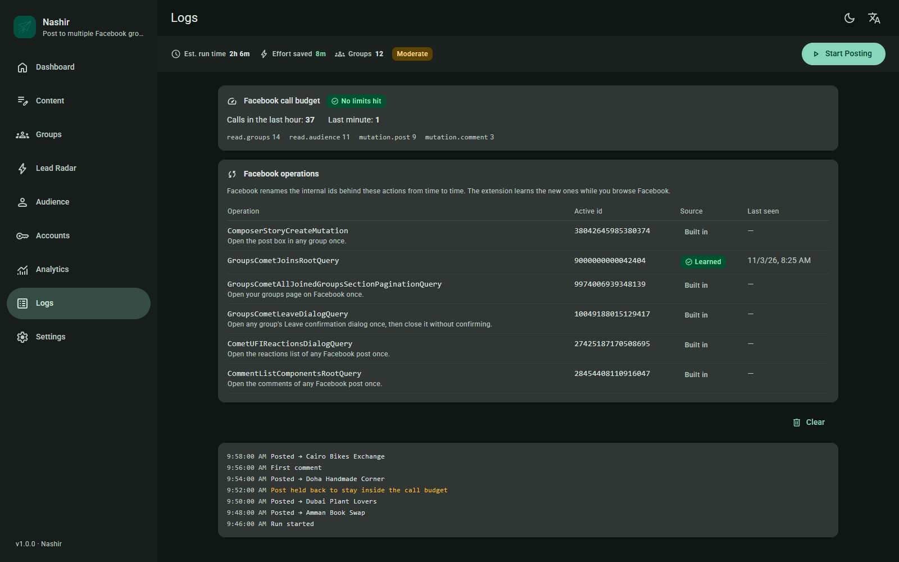
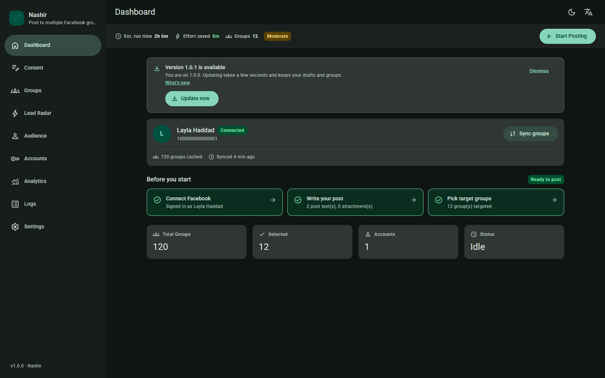

<div align="center">



# Nashir (ناشِر)

**Post to many Facebook groups, safely. A free, Arabic-first Chrome extension.**

[](https://github.com/abdumezar/extensions.facebook.auto/actions/workflows/ci.yml)
[](https://github.com/abdumezar/extensions.facebook.auto/releases/latest)
[](LICENSE)
[](https://github.com/abdumezar/extensions.facebook.auto/releases)

English | [العربية](README.ar.md)

[Download](https://github.com/abdumezar/extensions.facebook.auto/releases/latest) · [Website](https://abdumezar.github.io/extensions.facebook.auto/) · [Changelog](CHANGELOG.md)

</div>

> [!WARNING]
> Nashir automates Facebook's internal endpoints with your own logged-in session. That is against Facebook's Terms. Use it at your own risk: your account may be restricted. See [Disclaimer](#disclaimer).



Write a post once, choose the groups, and Nashir publishes it group by group at a safe pace. It tells you how each group went, and it stops when Facebook asks for a check or signals a limit. A built-in safety governor keeps every call to Facebook inside a budget, with cooldowns and pacing. Everything stays on your device: no server, no telemetry, no account.

Requires Chrome 116 or newer.

## Contents

- [Features](#features)
- [Install](#install)
- [Updating](#updating)
- [Safety model](#safety-model)
- [Privacy](#privacy)
- [Disclaimer](#disclaimer)
- [Build from source](#build-from-source)
- [Project structure](#project-structure)
- [Contributing](#contributing)
- [License](#license)
- [About the developer](#about-the-developer)

## Features

- **Campaigns.** Post to many groups at once, with per-campaign delays and a result for every group.
- **Multiple accounts.** Run campaigns from several of your own Facebook accounts (cookie-based).
- **Safety governor.** A Facebook call budget, cooldowns, pacing and per-feature caps. The **Facebook call budget** card on the Logs page shows recent call counts and, during a cooldown, the rule that matched.
- **Audience extraction.** Collect the people who reacted to or commented on a post, including contact details they typed themselves in a comment. Export to CSV or JSON, or hand a number over to WhatsApp.
- **Lead Radar.** Checks your watched groups about every 15 minutes and scores posts that look like buying intent. It uses plain keyword rules, no model.
- **Auto first comment.** Add your link or details as the first comment under a post.
- **Group discovery and joining.** Find groups and join them in small batches: at most 8 a day and 3 per batch, with spacing between joins. You can also leave groups.
- **Large accounts.** The Groups page is paginated, and group sync is resumable, so very large group lists finish loading.
- **Analytics.** See what you posted, where, and how it went. Export to CSV.
- **Facebook operations card.** Facebook renames its internal identifiers (`doc_id`s) from time to time. Nashir re-learns them from Facebook's own pages and shows which ones are current.
- **One-click signed updates.** New versions come from GitHub Releases. The signature is checked before anything is written. See [Updating](#updating).
- **Arabic first.** Arabic interface by default, English too, in light and dark themes.

<table>
  <tr>
    <td width="50%"><br><sub>A campaign running: one line per group, with its result.</sub></td>
    <td width="50%"><br><sub>The audience page, with filters and export.</sub></td>
  </tr>
  <tr>
    <td width="50%"><br><sub>The Facebook operations card shows which operations are current.</sub></td>
    <td width="50%"><br><sub>The update banner, shown when a new version is out.</sub></td>
  </tr>
</table>

## Install

Nashir is not on the Chrome Web Store, because the store is not a fit for this kind of automation. You install it from GitHub. It takes a couple of minutes and needs no tools.

1. **Download and unzip.** Download `nashir-<version>.zip` from the [latest release](https://github.com/abdumezar/extensions.facebook.auto/releases/latest). Unzip it into a normal folder such as `Documents\Nashir`. Do not use `AppData`, a temporary folder or Downloads: Chrome reads the extension from this folder every time it starts, so it has to stay put.
2. **Turn on Developer mode.** Type `chrome://extensions` in Chrome's address bar and press Enter. Switch on **Developer mode** in the top corner.
3. **Load the folder.** Click **Load unpacked** and choose the folder you unzipped. Nashir appears in the list. Pin it to the toolbar if you like.
4. **Link the folder once.** Open the Nashir dashboard, then go to **Settings** > **Updates** and click **Link folder**. Choose the same folder again and allow access. This is what lets the extension update itself later with one click. If you skip this step, **Update now** will show a button to choose the folder.

The release also carries `nashir-<version>.zip.sig` and `SHA256SUMS`. The extension uses the signature itself. If you want to check your download by hand, compare its SHA-256 hash with the matching line in `SHA256SUMS`.

## Updating

When a new version is out, a banner appears in the dashboard.

1. Click **Update now** in the banner.
2. Allow access to the folder if Chrome asks.
3. Nashir checks the release's signature first. Only if it matches does it write the new files. Then the extension reloads itself on the new version.

If a campaign or another background job is running, Nashir asks you to wait until it has finished, so nothing is cut off halfway.

To update by hand: download the new zip, unzip it over the same folder, open `chrome://extensions` and press **Reload** on Nashir.

An update replaces the extension's files only. Your campaigns and settings are kept by Chrome separately and stay as they are.

## Safety model

Nashir is built to go slowly.

- Every call to Facebook goes through one governor with a call budget, pacing and cooldowns. Recent counts show on the Logs page.
- When Facebook signals a limit, Nashir pauses and shows the rule that matched.
- When Facebook asks you to confirm it is you, Nashir stops all calls for that account until you finish the check.
- Features have their own caps. Group joining, for example, is limited to 8 a day and 3 per batch, with spacing between joins.
- Updates are verified against a signature before any file is written, and a failed write is rolled back.

The governor lowers the risk of a restriction. It cannot remove it.

## Privacy

- Campaigns, groups, audiences and settings are stored in your browser, on your device.
- There is no Nashir server, no telemetry and no account. Nothing is collected about you or your activity.
- Besides Facebook's own servers, GitHub (update checks and downloads) is the only other address the extension contacts by itself. Links you click yourself, such as WhatsApp chat links, open normally.
- The code is open, so you can read exactly what it does.

## Disclaimer

Nashir automates Facebook's internal endpoints using your own logged-in session. That is against Facebook's Terms and can lead to restrictions on your account, including a temporary block or a ban. You use it at your own risk, and the authors are not responsible for what happens to your account.

Nashir is an independent project. It is not affiliated with, endorsed by or connected to Facebook or Meta.

## Build from source

You need Node.js 20 or newer (CI uses 22) and pnpm 10.

```bash
pnpm install
pnpm dev          # Vite dev build
pnpm typecheck
pnpm test
pnpm build        # output in packages/extension/dist
```

To try a build in Chrome, open `chrome://extensions`, turn on Developer mode, choose **Load unpacked** and select `packages/extension/dist`.

To package a release zip (run `pnpm build` first):

```bash
pnpm --filter @nashir/extension pack:ext
```

To regenerate the screenshots in this README:

```bash
pnpm --filter @nashir/extension screenshots
```

## Project structure

```text
packages/
  extension/            Chrome MV3 extension
    src/
      background/       service worker: message router, alarms, rule setup
      engine/           campaigns, call governor, groups, audience, Lead Radar
      platform/         thin adapters over Chrome APIs
      content/          content script that runs on facebook.com
      dashboard/        React dashboard (Arabic and English)
      popup/            toolbar popup
      update/           update check, signature check, unpack and apply
    scripts/            build, packaging and release-signing scripts
  shared/               types, messaging contracts and the Facebook recipe
site/                   GitHub Pages website
```

## Contributing

Bug reports, fixes, translations and documentation are welcome. Read [CONTRIBUTING.md](CONTRIBUTING.md) for setup, checks and commit style. If an operation stops working, open an issue and name the operation shown on the Facebook operations card.

Report security problems privately, never in a public issue. See [SECURITY.md](SECURITY.md).

Please follow the [Code of Conduct](CODE_OF_CONDUCT.md).

## License

Nashir is released under the [GNU General Public License v3.0](LICENSE) (GPL-3.0-only).

## About the developer

**Abdulrhman Mezar**

Software engineer — full-stack .NET and TypeScript. I design, build and ship complete production systems, with Arabic (RTL) and English interfaces by default.

- GitHub: [github.com/abdumezar](https://github.com/abdumezar)
- LinkedIn: [linkedin.com/in/abdumezar](https://linkedin.com/in/abdumezar)
- Email: [abdumezar@gmail.com](mailto:abdumezar@gmail.com)
